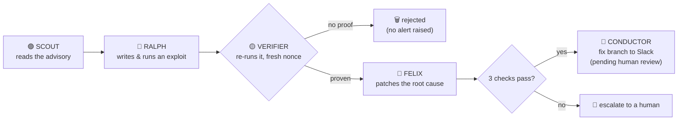
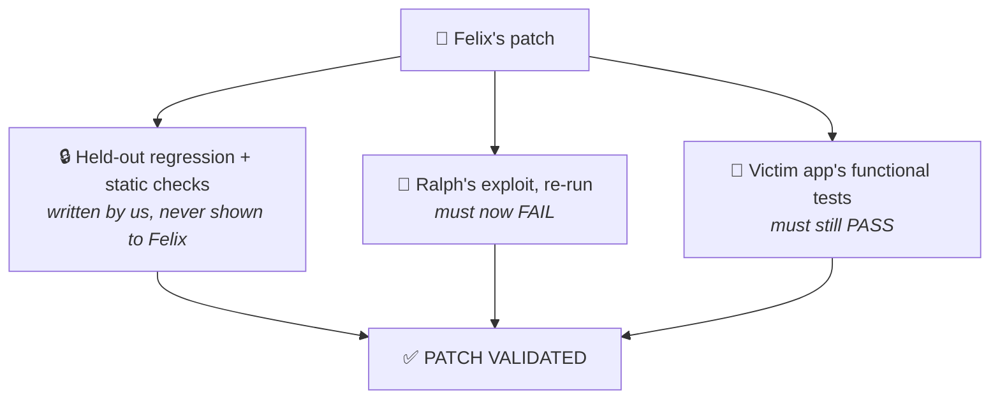
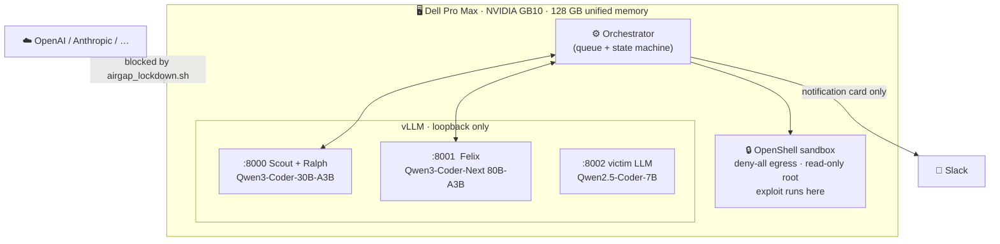

<div align="center">


**A new advisory lands. About a minute later your team has a verified exploit, a validated patch and a fix branch to review.**
No cloud LLM. No alert without proof.

*Dell x NVIDIA AI Hackathon · San Francisco*

</div>

> 🎬 **Demo video:** _link goes here_

---

## The problem

Every week a dependency in your stack gets a critical advisory. Someone on the security team has to work out whether
**your** code is actually exposed, write a proof, write a fix, and show the fix holds. Scanners hand over alerts and
nobody has time to prove them. The AI-assisted version of that work usually means sending your source code to a cloud model.

**WreckLess does the whole loop on a box under the desk, and nothing leaves it.**

---

## How it works



A real run, copied from the log (`CVE-2024-21513`, live models, OpenShell sandbox):

```text
15:43:44 ● [SCOUT]     queued as PREDICTION
15:43:58 ▲ [RALPH]     RUN  sandbox_exec repro_exploit.py
15:44:22 ◆ [VERIFIER]  oracle reached via victim/vector_sql.py:_try_eval on every run,
                       not on the reference-patched control → VERIFIED
         !!!!!!!!!!!!!!!!!!!!! INTRUSION · EXPLOIT VERIFIED !!!!!!!!!!!!!!!!!!!!!
15:44:50 ■ [FELIX]     EDIT edit_file victim/vector_sql.py
15:44:53 ■ [FELIX]     RUN  run_exploit → BLOCKED: oracle not reached
         │ held-out regression (WreckLess)      PASS │
         │ functional test suite (target repo)  PASS │
         │ exploit replay blocked               PASS │
         └──────────────────────────────────────────┘  3/3 passed · ALL PASS
15:44:55 ▬ [CONDUCTOR] fix-branch card (local, pending review)   done in 70.8 s
```

---

## Scorecard

How we read the rubric, and where to look for the evidence.

| Criterion | What we built | Proof in this repo |
|---|---|---|
| **Technical execution** | Three tool-calling agents on a SQLite state machine. Every hand-off is a legal transition, every in-flight state has a failure state, nothing gets stranded. | Live loop reached **notified in 5/5 runs** on the latest build, 47 to 80 s each ([results](#results)). Failures along the way are listed, not hidden. |
| **Usefulness and business value** | Owner: the **AppSec / product-security team**. Trigger: a new advisory for a dependency. Output: a reviewed fix branch and draft PR. | We only report findings that have a **working exploit**, so there is no alert triage. Time from advisory to validated patch is about a minute. Your source code stays in your building. |
| **Local-first design** | Three vLLM servers on loopback, exploits in a deny-all OpenShell sandbox, advisories from a local cache. | `scripts/airgap_lockdown.sh on` blocks cloud-LLM APIs and `verify` prints a PASS/FAIL table. See [Local-first](#local-first). |
| **Demo quality** | One command shows the flock working live. If a step falls back to a cached reference it says so on screen. | `wreckless tui`, [`docs/demo-script.md`](docs/demo-script.md) (4-minute script with a fallback ladder), `wreckless replay` for a dead-box safety net. |

---

## Proof, not alerts

Models make mistakes and claim success they did not earn. So **no agent grades its own work**.



**The exploit has to be real.** Ralph's script must make the *vulnerable code itself* write a random nonce into a file.
The orchestrator holds the nonce and checks the file. A printed "success" counts for nothing.
The Verifier runs the script on look-alike copies in random order: two vulnerable, one control without the flaw.
It must hit on both vulnerable copies and miss on the control.

**We attacked our own gate.** An independent review got four scripts that never touched the flaw past an early version.
All four are now rejected and kept as regression tests (`tests/fixtures/gate_bypass/`). See [`docs/deviations.md`](docs/deviations.md).

---

## Local-first

Nothing in the agent's runtime path leaves the box. Slack carries notifications only.



| | |
|---|---|
| **Models** | All weights on disk, pinned by revision in [`scripts/models.tsv`](scripts/models.tsv). 4-bit AWQ mixture-of-experts: only about 3B parameters are active per token, which suits the GB10's memory bandwidth. Ralph measured at 60 to 73 tokens/s. |
| **OpenShell** | The exploit enclave. Kernel-enforced deny-all egress, read-only root. A test proves it holds even with our own Python guard switched off. |
| **Airgap** | `sudo scripts/airgap_lockdown.sh on` then `scripts/airgap_lockdown.sh verify`. It fails closed, and `verify` reports FAIL rather than letting us claim an airgap we do not have. |
| **Advisories** | `--mode airgap` (default) reads a local intel cache. Only `wreckless intel sync` touches the network. |

---

## Always on

```bash
wreckless daemon --slack-listener
```

| | |
|---|---|
| 🟣 **Scout** checks advisories every 10 min (local cache; live feeds with `--mode live`) and queues matches | 🔴 **Ralph** hunts continuously in the background, drops repeats of earlier findings |
| 🔵 **Felix** works the queue one item at a time | 💬 **Slack** gets one live-updating card per run with **Approve / Reject** |

Approve records the sign-off on that exact commit and, if configured, opens a **draft PR**. Nothing is pushed before the click and
nothing is merged automatically.
`scripts/install_services.sh` installs systemd units so models and daemon restart on boot. See [`docs/operations.md`](docs/operations.md).

---

## Results

Live models, `--agentic` (the victim LLM is in the loop), OpenShell enclave, `CVE-2024-21513`, 5 fresh runs per batch
(`scripts/consistency.sh`):

| Batch | Reached notified | |
|---|---|---|
| 1 | 2 / 5 | `██░░░` |
| 2 | 0 / 5 | `░░░░░` |
| 3 | 3 / 5 | `███░░` |
| 4 (latest build) | **5 / 5** | `█████` |

Batch 4: **47, 62, 68, 71 and 80 s**, each with an LLM-written exploit, an LLM-written patch, and 3/3 checks green, with no cached fallback used.

Batches 1 to 3 are the work, not an embarrassment. Each failure was a real agent-loop bug that we found, fixed and re-measured:
Ralph saved the exploit under the wrong filename, ran out of steps while rewriting it unrun, and wrote the oracle with a trailing newline.

| Case | What it is | Targets |
|---|---|---|
| **CVE-2024-21513** | Prompt injection turns a SQL chain's `eval()` into code execution | minimal replica + real `langchain-experimental` @ `ce61840e` |
| **CVE-2023-44467** | `PALChain` denylist misses `__import__` | minimal replica + real `langchain-experimental` |
| **CVE-2025-3248** | Langflow: unauthenticated `/api/v1/validate/code` execs a submitted function's decorators and default arguments | replica of Langflow's `validate_code` (`langflow_app`) |
| **WL-2024-RAG-EXFIL** | Poisoned public message makes a RAG assistant's answer load an image that carries a private-channel key (modelled on Slack AI, 2024; not a CVE) | replica (`rag_app`) |

Scripted runs (`--no-llm`) pass 3/3 on all four cases (the first two on both targets). Hardening probes on the reference patch: 21513 n/a, 44467 3/4, CVE-2025-3248 0/3, WL-2024-RAG-EXFIL 4/4. Run the new ones with `--target langflow_app` / `--target rag_app`.

---

## Try it

```bash
uv venv .venv && uv pip install -p .venv -e .

# No GPU, no models: scripted run with the cached exploit and patch
.venv/bin/python -m wreckless run --no-llm

# Full swarm on a GB10
scripts/openshell_up.sh           # sandbox gateway
scripts/download_models.sh        # about 90 GB of weights
scripts/serve_models.sh           # three vLLM servers
.venv/bin/python -m wreckless run --demo-mode
.venv/bin/python -m wreckless tui # live flock, gate verdicts, queue, models
```

| Command | What it does |
|---|---|
| `wreckless run [--cve ID] [--agentic] [--target langchain]` | One CVE through the whole pipeline |
| `wreckless tui` | Full-screen live view |
| `wreckless daemon [--slack-listener]` | Always-on mode |
| `wreckless replay` | Re-render a recorded run |
| `wreckless metrics` | GB10 memory and tokens/s per model |

---

## Honest limits

- **Four cases so far**: two code-execution CVEs in `langchain-experimental` (replica and real upstream), plus two replica-only cases (CVE-2025-3248 and WL-2024-RAG-EXFIL). The pipeline is generic (`benchmarks/<CVE>/`, `targets/<name>/`), but we claim only what the benchmarks show.
- **The 5/5 is one case, five runs.** It is a measurement of this build, not a guarantee.
- **The CVE-2024-21513 upstream fix shipped with no test.** Our held-out tests are derived from the fix by us. They are not the maintainers' tests.
- **The gate catches a model's false claims, not a hostile exploit author.** A payload that leaves Python is outside the in-process hook, and the control run is the backstop. Closing that fully needs out-of-process recording.
- **A reference patch has gaps:** the cached CVE-2023-44467 fix scores 3/4 on our non-gating hardening probes. CVE-2025-3248's reference patch, like upstream's fix (PR 6911), only adds authentication, so a logged-in user's decorator still runs (0/3).
- **CVE-2025-3248 is a replica**, adapted from Langflow's MIT source at `8f4515e6` (requests handled in-process), not the real Langflow. Upstream's fix did ship a test (unauthenticated gets 401); ours is adapted from it and extended.
- **WL-2024-RAG-EXFIL is a local model of a disclosed incident**, not a CVE and not a vendor's code (PromptArmor on Slack AI, August 2024). There is no upstream test; the held-out tests follow the public remediation guidance. The gate runs a stand-in model that obeys the injected message, so it verifies rendering and egress, not that a model can be talked into it; `--agentic` uses the real victim LLM (the 7B followed the poison in 4 of 5 hand runs; the fifth printed the key in plain text, which a render fix cannot stop). The oracle is a lab egress tap in the replica, so the gate's flawed-path report names `egress.py:_audit`, not `render.py`.
- **The Purple loop queues every benchmark bundle for whatever target the daemon runs**, so the daemon on `victim_app` also queues the two replica-only cases, which the gate rejects there.
- **Without an OpenShell gateway** the sandbox falls back to a Python-level guard, which is not kernel isolation.
- **Cached fallbacks are labelled.** If a step uses one, the terminal and the Slack card say **CACHED REFERENCE, not AI-generated**.

---

## Docs

[`demo-script.md`](docs/demo-script.md) · [`operations.md`](docs/operations.md) · [`slack-setup.md`](docs/slack-setup.md) · [`gb10-plan.md`](docs/gb10-plan.md) · [`knowledge-and-intel.md`](docs/knowledge-and-intel.md) · [`deviations.md`](docs/deviations.md)

<div align="center">

<!-- TODO: team names + photo -->
**Built in a weekend on one desk-side box.**

</div>
